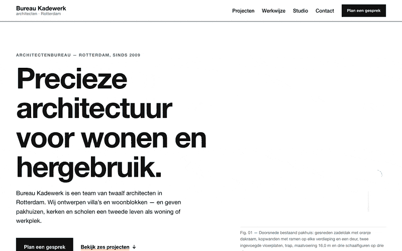

# architect-demo

A test run of the `wp-frontend-builder` Vibe agent from
[mistral-toolbox](https://github.com/imagewize/mistral-toolbox). From a short brief, the agent
built a homepage for an invented Rotterdam architecture firm, **Bureau Kadewerk**, as one
self-contained HTML/CSS file. The aim is to test the loop: build from a brief, revise with change
requests, then convert to a WordPress block theme.



- **Agent:** `wp-frontend-builder` (Mistral Vibe, Mistral Large 4)
- **Toolbox version:** `main` at `8240385` (v1.6.1 plus unreleased fixes #28–#30)
- **Output:** [`index.html`](index.html), with Dutch copy, a Swiss style, inline SVG drawings and no external requests

## Setup

`.vibe/config.toml` points Vibe at the toolbox skills. The agent profiles are found through the
user-level symlink `~/.vibe/agents` → `~/code/mistral-toolbox/agents`.

```bash
vibe --agent wp-frontend-builder
```

## View

```bash
open index.html
```

To check phone layouts, use the browser's device toolbar at about 390px wide.

## Run 1

The brief and every later prompt are in [`PROMPTS.md`](PROMPTS.md).

**What the agent did:**
- loaded `frontend-design`, `no-ai-design-slop` and `frontend-ui-engineering`, and skipped `landing-page`
- stated its assumptions first: Dutch copy, a Swiss style with an International Orange accent, the system Helvetica font, a `mailto:` form and no JavaScript
- checked its own output: tag balance, `--wp--preset--*` token use, no `url()`, form labels and WCAG contrast for every text and background pair
- rendered the page in headless Chrome at phone and desktop widths

**Review notes, to send as the next change request:**
1. The hero drawing has a tilted orange rectangle on the roof that reads as a stray mark. Make it a proper skylight or remove it.
2. On the "Over het bureau" map, the studio label overlaps the bridge pylon. The caption says "Rotterdam-Noord", but M4H is in Rotterdam-West (Delfshaven).
3. There is empty space under the facts table in "Over het bureau", and the right half of the quote section is empty.
4. The sticky header is 122px tall on phones. Make it non-sticky on small screens, or fold the nav into a toggle.

## Change requests and conversion

[`PROMPTS.md`](PROMPTS.md) has the prompts to apply review notes, to review the page with
`html-page-review`, and to convert the page to WordPress — either into a self-contained block
theme (prompt 10) or assembled from Aludra blocks on an Aviendha fork (prompt 11). Commit after
every run you keep.

## Stand-ins, not finished

- **Form:** posts via `mailto:`, which opens the visitor's mail app. In WordPress it becomes a form plugin or block.
- **Firm and content:** the firm, projects, client quote and phone number are invented. The street names and districts are real.
- **Name, email and phone:** the firm was first called Studio Veld Architecten and was renamed to Bureau Kadewerk, because `studioveld.nl` is registered to someone else. The email and phone are placeholders: `studio@example.com` (a domain reserved for examples) and `+31 (0)10 000 00 00`.
